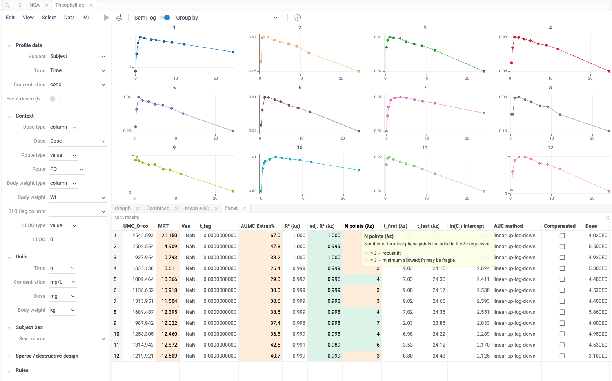
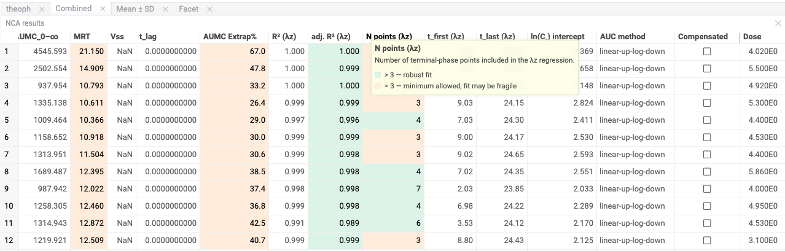

# NCA

Non-Compartmental Analysis of preclinical pharmacokinetic data [package](https://datagrok.ai/help/develop/#packages)
for the [Datagrok](https://datagrok.ai) platform.

It takes a study from a raw concentration-time table to a defensible set of PK parameters —
*how high exposure went, how fast the drug cleared, how much reached circulation* — and lets
you explore, stratify, and hand off that result without leaving the browser or writing a line
of code. It covers **single-dose discovery screens**, **IND-enabling and toxicokinetic studies**
with serial and sparse sampling, **bioavailability** and **dose-proportionality** assessments,
and **NONMEM-format** event datasets.

Launch it from the **Apps** browser under **Compute → Non-Compartmental Analysis**.



## Where it fits

The package picks up **where the bioanalytical table leaves off** and carries the study through
to interpretable PK. It does not replace your LC-MS/MS pipeline or your PK/PD modeling tool, and
it is not a compartmental fitter — you bring the concentration-time data, it returns
non-compartmental parameters.

The math is not the differentiator. WinNonlin has decades of validated calculations; PKNCA is
open and complete. Every NCA computation here runs through
[`@datagrok-libraries/sci-comp`](https://github.com/datagrok-ai/public/tree/master/libraries/sci-comp),
the validated core that matches PKNCA within **0.1% on AUC**, **0.5% on λz**, and **1% on derived
parameters** against the shared reference suite (theophylline, indomethacin, rat). What neither of
those tools offers is the part that sits *around* the math: mapping a messy vendor table in
seconds, seeing every subject's profile and parameter side by side, stratifying by route and sex
with one control, and keeping the whole thing reproducible and shareable as a study — not
scattered across scripts and spreadsheets.

## What you can achieve

### If you screen compounds — the discovery DMPK scientist

- **Rank a plate, not a profile.** Load a batch of compounds, map columns once, and compute
  Cmax, AUC, t½, CL and Vz for every subject in a single pass — then sort, color, and aggregate
  by group to see which compounds clear fast and which sustain exposure.
- **Read the whole screen at a glance.** Faceted per-subject plots and a group mean ± SD profile
  put twenty animals on one screen; a semi-log toggle turns the terminal phase into a straight
  line you can eyeball. Selecting rows in the results grid highlights their curves, so a parameter
  outlier is one click from its profile.
- **Trust a value, or see why not.** Results cells are color-tiered (ok / warning / critical), and
  every parameter carries its provenance — the λz fit window, R², point count, and the warnings
  stream from the compute core — so a fragile 3-point terminal slope or a >50% extrapolation reads
  as *fragile*, not as a clean number.



### If you run regulated studies — the preclinical PK / TK scientist

- **Handle the designs formal studies actually use.** Serial and sparse (destructive /
  batch) sampling, IV bolus with C₀ back-extrapolation, IV infusion with duration-corrected MRT
  and Vss, and repeat-dose toxicokinetics are all first-class inputs — not workarounds.
- **Get the derived set, honestly.** Beyond AUC and Cmax the package writes AUMC, MRT, Vss, tlag,
  and %-extrapolated (AUC and AUMC), with unfit parameters left as honest `NaN` rather than
  censored or back-filled.
- **Answer the study's real questions.** Bioavailability (F%) across routes, dose proportionality
  via the Smith power model with a 90% CI and verdict, accumulation ratios and exposure margin for
  repeat-dose TK, and sparse-design AUC with Bailer/Holder bootstrap confidence intervals — each
  stratified by route and sex.
- **Leave an audit trail.** Every compute is logged with a deterministic rule fingerprint and
  per-subject provenance; the record follows the PRD's IR-12 shape with a documented 21 CFR
  Part 11 / ALCOA+ retrofit path.

## Supported inputs

| Format | Shape | Notes |
|--------|-------|-------|
| **Standard concentration-time** | one row per sample | Subject, time, concentration required; dose / route / body weight / BLQ optional, per-row or as a scalar |
| **Multi-route** | route per row | IV-bolus, IV-infusion, PO, SC, IM in one table; CL/Vz basis (absolute vs `/F`) resolved per row |
| **NONMEM event dataset** | EVID / AMT / CMT / RATE / MDV | Event records normalized into subject / time / concentration / dose columns, including infusion `RATE` and per-day resets |
| **Sparse / destructive** | nominal time + animal pool | Pooled composite profile with bootstrap CI, for designs where no single animal has a full curve |

Data enters as a CSV upload or any open Datagrok table. Columns are **auto-filled** from name
hints (subject, time, conc, dose, body weight, BLQ, LLOQ, route) and unit tokens are parsed from
suffixes (`Conc_ng_mL` → ng/mL, `Time_hr` → h) — you confirm or override in the mapping pane.
CSV numeric columns are re-read to Float64 to recover the precision needed for PKNCA bit-identity.

## Workflow

The analysis lives in one view: a docked **mapping pane** on the left, the **results grid** and
**profile charts** on the right. You map, tune the method, compute, and the relevant stratified
panels appear as tabs alongside the results.

```
Map columns → Set method rules → Compute → Explore profiles & parameters → Stratify → Save to study / Share
```

### Map
Pick subject, time, and concentration (required); optionally map dose, route, infusion duration,
body weight, BLQ flag, LLOQ, and sex (with per-value M/F/U coding). Set units for time,
concentration, dose, and body weight. Toggle **Sparse design** to map nominal time and the animal
pool explicitly.

### Set method rules
AUC method (linear, log-linear, or linear-up-log-down) with optional compensated summation; BLQ
handling per phase (pre-first, embedded, after-last, trailing); λz minimum points and minimum
adjusted-R², Cmax exclusion, and tie-break; extrapolation warn/error thresholds. λz is fit by
automatic best-fit; the terminal window and its statistics are written back per subject.

### Compute
The controller validates the mapping, indexes one profile per subject, extracts inputs, and calls
`nca.computeNca` per subject. A failure on one subject is isolated — it is marked `failed` and the
rest still compute.

### Explore
- **Results grid** — one row per subject, ~30 columns, color-tiered cells, sortable and
  exportable; warning and provenance JSON columns are carried but hidden by default.
- **Profile chart** — observed concentration vs time, with a semi-log toggle; selecting results
  rows highlights the matching curves.
- **Facet grid** — one subplot per subject.
- **Mean ± SD profile** — group mean with sample-CV%, pooled on nominal time when a sparse design
  is mapped.

### Stratify
- **Group by** — aggregate to group-level mean ± CV by route, status, sex, dose, study day, or any
  carried metadata column.
- **Bioavailability** — F% per route × sex stratum (× study day on a confirmed repeat-dose
  design), with CL and CL/F.
- **Dose proportionality** — Smith power-model slope with 90% CI and a proportional /
  sub / super verdict per route × sex × study day, plus a dose-normalized view.
- **Sex comparison** — female / male fold-change per dose (× study day when the study has
  several days).
- **Day N / Day 1 & exposure margin** — Rac(AUC), Rac(Cmax) and human/animal exposure margin for
  repeat-dose TK.

The study day (or period / occasion) column is detected by name and confirmed in Settings,
together with the animal key and the design (repeat-dose, crossover, escalation).
- **Sparse NCA** — pooled composite AUClast with Bailer/Holder bootstrap CI, a composite profile,
  and an AUC-vs-dose scatter.

### Save & share
Organize analyses under **studies**: each analysis stores its recipe and recomputes lazily when
reopened, a summary cache renders the study overview, and studies or individual analyses can be
shared through the platform's permission model (with a warning when a source table is
session-only and cannot travel).

## Computed parameters

Written to the results DataFrame per subject (as Float64; unfit values are `NaN`):

| Group | Parameters |
|-------|------------|
| **Exposure** | Cmax, Tmax, AUC₀₋last, AUC₀₋∞, %AUC extrapolated |
| **Terminal phase** | λz, t½, λz R² / adj-R², points used, fit window (t-first / t-last), intercept |
| **Disposition** | CL or CL/F, Vz or Vz/F (route-dependent basis), C₀ (IV bolus back-extrapolation) |
| **Moment / absorption** | AUMC₀₋last, AUMC₀₋∞, %AUMC extrapolated, MRT, Vss, tlag |
| **Bookkeeping** | route, CL basis, dose-normalization basis, status, AUC method, compensated flag |

## Integrations & requirements

- **Demo studies are installed by a function call.** See *Demo data → Demo studies*: any user runs
  `ncaSeedDemoStudies()` once per server; after a sci-comp update, the demo's owner or an
  administrator runs it again to refresh it.

- **No credentials required.** The package computes locally against the platform and the bundled
  `sci-comp` core; it calls no external services.
- **`sci-comp` carries the math.** Built against `@datagrok-libraries/sci-comp` — numerical
  primitives (AUC methods, λz best-fit, BLQ phasing, moment analysis, bootstrap CI) live upstream
  and are validated there. This package is the adapter, controller, viewer, and study layer; it
  does not vendor or reimplement core algorithms.

## Demo data

### Demo studies (installed by an administrator)

Five demo studies of one simulated discovery program — Series X, eight
N-[4-(4-methylpiperazin-1-yl)phenyl]benzamide analogs, lead **DGK-0007** — can be installed into
the Hub, shared **View** with all users:

| Study | Design | What it shows |
|---|---|---|
| `Demo · rat IV/PO screen` | 8 compounds × (IV 1 mg/kg + PO 5 mg/kg), n = 3 | %F ranking with structures; a long-t½ compound accepted as is (span < 2, %AUCextrap > 20 %); a double peak (Not estimated) |
| `Demo · mouse sparse PO` | destructive, 3 mice / time / sex | UC-04 composites with Bailer uncertainty, one analysis per sex |
| `Demo · rat dose escalation` | IV 0.3 / 1 / 3, PO 3 / 10 / 30 mg/kg | dose proportionality; an Exclude λz with `(excl.)` and `n = 2 of 3` |
| `Demo · 28-day TK (rat)` | PO 0 / 10 / 30 / 100 mg/kg/day, Day 1 + Day 28 | Rac, sex ratio, exposure margin; a ✎ point override; vehicle controls (No exposure); **three profiles left To review** |
| `Demo · IV infusion (rat)` | 0.5 h infusion, 1 and 3 mg/kg | infusion MRT/Vss; a ✎ override extending λz; an end-of-infusion deviation |

**All data are simulated.** The SMILES are real molecules carrying fictitious PK; NOAEL, the human
dose and the exposure margin are design constants, not a determined NOAEL; the 100 mg/kg Rac of
≈ 1.7 comes from a planted time-dependent CL inhibition at that dose only. Generator, seeds, model
and the planted review matrix: [`files/REGEN.md`](files/REGEN.md) (*Demo studies*).

**Installing — required once per server, not automatic.**

1. Run `ncaSeedDemoStudies()` from the console (any user can). It checks each demo study and
   returns a report, one row per study:
   - **missing** → installed and shared View with *All users*; the caller becomes its owner and the
     analyst shown on every recorded override and decision;
   - **up to date** → nothing is written;
   - **out of date** (computed by another sci-comp version, or the package ships newer demo data) →
     re-installed when the caller is its owner or an administrator: deleted (final) and re-created
     with **new ids**, so copied links to it stop working; any other caller is told who can refresh
     it, and nothing is written;
   - a study of yours with a demo label but other analyses is refused, never deleted.
2. After the first install, open `Demo · rat IV/PO screen`: with the Chem package
   installed the eight structures render in the study grid; without it the SMILES text shows (the
   demo itself needs no Chem).
3. **After every update of `@datagrok-libraries/sci-comp`, the owner or an administrator runs it
   again** — otherwise every demo row reads `stale (refreshes on open)`, which View-only users
   cannot refresh.

Limits (a deliberate simplicity choice): the demo studies are ordinary studies — whoever installed
them owns them and can edit or delete them; each server is seeded by a manual call; two users calling
the function at the same moment on a server without the demo could both install it; there is no description field, so the
simulated status is carried by the `Demo ·` labels and the `(simulated)` table names.

### Sample tables

Two datasets are one click from the hub's sample library:

- **Theophylline** (`theoph.csv`) — 12-subject oral PK, the canonical PKNCA reference set.
- **Indomethacin** (`indometh.csv`) — 6-subject IV-bolus PK.

`files/` additionally ships the PKNCA validation corpus used by the test suite — single- and
multi-route rat PK, IV infusion, sparse destructive mouse sampling, 28-day repeat-dose TK, a
20-compound batch screen, and matching NONMEM-format variants — each with a byte-identical
reference for regression against the upstream numbers.

## Not yet in this release

Kept honest so you know the edges: interactive **click-to-include λz** point/range selection on the
chart is stubbed (auto-best-fit is the wired mode); there are no semantic-type detectors yet
(mapping is by name-hint auto-fill, not `SemType` tagging); molar concentration units (µmol/L),
body-weight units beyond kg/g, and multi-analyte / multi-occasion routing are deferred to later
cycles.

## Development

The package is part of the `public` pnpm workspace (see `packages/BUILD.MD`):

```bash
grok setup          # once per checkout, at the repository root
grok build          # bundle, generate function metadata, grok check
pnpm run typecheck
pnpm run lint
grok test           # against the configured Datagrok server
grok publish local  # deploy a debug build to a server alias
```

The NCA math (AUC, λz, BLQ handling, derived parameters) lives in `@datagrok-libraries/sci-comp`; this
package does not reimplement it. Fixtures and their regeneration are described in
[`files/REGEN.md`](files/REGEN.md).
