# PopPK Studio

## Overview

PopPK Studio (part of PharmaFlow) — a browser-native population PK/PD modeling module for the Datagrok platform. Implements the full pharmacometrics pipeline: NMTRAN data handling, compartmental models (analytical + ODE), NLME estimation (MAP → SAEM → FOCE-I), diagnostics (GOF, VPC, bootstrap), covariate modeling, Monte Carlo simulation, and regulatory-grade reporting. Serves four pharma personas:
- **Pharmacometricians** — code editor, DSL, full estimation control
- **Clinical pharmacologists** — GUI wizard, pre-built model library, self-service simulations
- **Biostatisticians** — exposure-response integration, MMRM bridge
- **Program leadership** — interactive dashboards, scenario comparison, executive reporting

No browser-native competitor exists in this space.

---

## Existing software

| Platform | Owner | Est. methods | Key weakness for us |
|----------|-------|-------------|-------------------|
| [NONMEM 7.6](https://www.iconplc.com/solutions/technologies/nonmem) | ICON plc | FO, FOCE-I, SAEM, NUTS | No GUI, no visualization, Fortran syntax, fragmented 4–6 tool workflow |
| [Monolix 2024R1](https://www.simulations-plus.com/software/monolix/) | Simulations Plus | SAEM only | No FOCE (complicates NONMEM comparison), desktop-only, no collaboration |
| [Phoenix NLME 8.7](https://www.certara.com/software/phoenix-nlme/) | Certara | FOCE, QRPEM | No SAEM, no Bayesian, Windows desktop only |
| [nlmixr2 4.0](https://nlmixr2.org/) | Open-source (R) | FOCE-I, SAEM | No GUI, steep learning curve, R-only |
| [Pumas 2.8](https://pumas.ai/) | PumasAI (Julia) | FOCE, SAEM, NUTS | Julia unfamiliar to most PMx, small community, opaque pricing |
 
**Gap**: zero browser-native platforms → zero unified workflows → 6–8 week analysis cycles.

→ *Full competitive analysis: [Pharmacometrics Software Competitive Landscape](software.md)*

---

## Target users

| Persona | Role | What they do | Primary pain |
|---------|------|-------------|-------------|
| **PMx** — [Pharmacometrician](persona_pharmacometrician_en.md) | Builds PopPK/PD models end-to-end | Writes control streams, runs estimation, VPC, bootstrap, regulatory reports | 4–6 disconnected tools; hours debugging Fortran syntax; no collaboration |
| **CP** — [Clinical Pharmacologist](persona_clinical_pharmacologist_en.md) | Translates models into clinical decisions | Dose justification, special populations, drug label sections | Every "what if?" takes days; black-box dependency on PMx |
| **BS** — [Biostatistician](persona_biostatistician_en.md) | Designs trials, runs E-R analyses | MMRM, exposure-response, sample size calculations | 2 days merging PMx exposure metrics with efficacy datasets |
| **PM** — [Program Leadership](persona_program_leadership_en.md) | Makes dose selection decisions | Reviews M&S results, presents to governance and FDA | Static slides; can't answer ad-hoc questions; $500K–$2M/week delay cost |

→ *Full persona cards and user journey maps:*
- *[Pharmacometrician](persona_pharmacometrician_en.md)*
- *[Clinical Pharmacologist](persona_clinical_pharmacologist_en.md)*
- *[Biostatistician](persona_biostatistician_en.md)*
- *[Program Leadership](persona_program_leadership_en.md)*

---

## Pipeline

**Input**: dosing records, PK blood samples, PD biomarker measurements, patient covariates (weight, age, renal function, genotype) — typically in NMTRAN format (ID, TIME, DV, AMT, EVID, CMT).

**Output**: dose recommendations for target populations, Clinical Pharmacology section of drug label, design of next clinical trial phase, regulatory-grade PopPK report (Module 2.7.2 eCTD) for FDA/EMA submission.

---

## Minimal algorithm set

28 algorithms required for MVP and first population estimation capability.

| Category | Count | Already in Datagrok | Key algorithms |
|----------|-------|-------------------|----------------|
| ODE Solvers | 5 | **5 of 5** | Rosenbrock, RK3/4/DP, Adams AB4/5, **LSODA**, **CVODE** |
| Analytical PK | 2 | 0 | Matrix exponential, superposition for multi-dose |
| Optimization | 4 | **1 of 4** | **Nelder-Mead**, L-BFGS, L-BFGS-B, Levenberg-Marquardt |
| NLME Estimation | 3 | 0 | MAP/EBE, SAEM, Metropolis-Hastings sampler |
| Linear Algebra | 4 | 0 | Cholesky, LU, eigendecomposition, log-determinant |
| Statistics | 7 | **3 of 7** | MVN sampling/density, seedable PRNG, **Monte Carlo**, **Sobol**, CWRES, shrinkage |
| Diagnostics | 3 | ~1.5 | GOF plots, QQ-plot, individual fits (partial viewer support) |
| **Total** | **28** | **~10.5** | **~19% coverage** |

Strongest coverage: **ODE solving is 100% complete** (including LSODA and SUNDIALS CVODE — the same solvers used by NONMEM and Monolix). Primary gaps: NLME estimation (0/3), linear algebra (0/4), optimization (1/4).

→ *Full algorithm catalog with references and libraries: [Algorithms and Numerical Methods](PopPK_Studio_Algorithms_and_Methods.md)*

→ *Terminology: [Glossary](glossary_en.md)*
